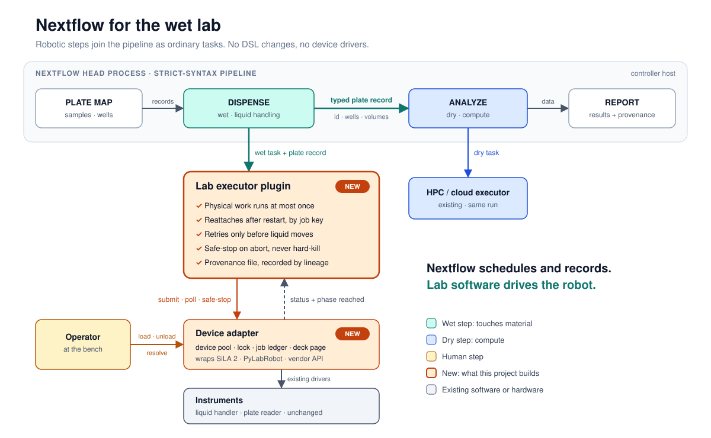

# nf-labrobotics

Robotic wet-lab steps in Nextflow pipelines, through a plugin. One pipeline mixes wet steps (a robot transfers a plate, extracts RNA, runs a PCR) and dry ones (analysis), with no change to the Nextflow language. A wet step never runs twice: not on retry, `-resume` or a new launch directory. Aborting a run safe-stops a robot instead of killing it mid-protocol. Each wet task's provenance (device, protocol version, samples) goes into Nextflow lineage.

Prototype, built against PyLabRobot's simulated machines; no real robot needed.

**[Take the tour](https://vagkaratzas.github.io/nf-labrobotics/)**: follow one plate from a pipeline to a simulated robot and back, in your browser. Abort the run, press E-stop, `-resume`.



## Quickstart

Prerequisites: Java 17, [uv](https://docs.astral.sh/uv/), Nextflow 26.10.0 or later on `PATH`.

```bash
make install                                                               # builds the plugin into ~/.nextflow/plugins
cd dashboard && uv run uvicorn nf_lab_dashboard.app:main --factory --port 8080
```

Open http://127.0.0.1:8080, pick `parallel_extraction` and press **Side by side**: one plate is split into RNA and DNA aliquots, extracted at once on two simulated liquid handlers, then PCR on a thermocycler, while a narrator plays the person at the bench. `plate_transfer` → **E-stop** shows the abort, the safe-stop and a `-resume` that runs only the stopped plate again. The demos need port 8000 free ([dashboard/README.md](dashboard/README.md#demos)).

## What's in the repo

| Path | What | Guide |
|---|---|---|
| `src/` | The Nextflow plugin (Groovy): the `labrobotics` executor, the `labrobotics {}` config scope, the `labPlate` function | this README |
| `adapter/` | The device adapter (Python, FastAPI, SQLite): the job ledger, robot pool, queues, the deck page for people, the bindings that drive PyLabRobot's simulated machines; `labctl`, the client a wet task runs; `openapi.json`, the contract; the conformance kit | [adapter/README.md](adapter/README.md) |
| `wet-modules/` | Nextflow modules, one per protocol, nf-core style, and subworkflows that chain them | [wet-modules/README.md](wet-modules/README.md) |
| `examples/` | Pipelines: `plate_transfer`, `plate_assay` (transfer, then read), `parallel_extraction` (extraction, then PCR), `qpcr` (1000 samples: extraction, then RT-qPCR), `lab_tour` (five routines over every simulated machine); `hello` | their `main.nf` and `nextflow.config` |
| `dashboard/` | Live view of a run (Nextflow, adapter calls, ledger, robots) and scripted demos | [dashboard/README.md](dashboard/README.md) |
| `validation/` | End-to-end checks of the guarantees, in CI | [Tests](#tests) |

## In a pipeline

A wet step is an ordinary process: label `process_wet`, a capability hint, and a script that runs `labctl run --protocol <name>` (see any module in `wet-modules/modules/`). The pipeline's config sends those processes to the `labrobotics` executor and says how to reach the adapter:

```groovy
plugins { id 'nf-labrobotics@0.1.0' }

labrobotics {
    adapter = 'http://127.0.0.1:8000'   // unset: $NF_LAB_ADAPTER
    poll = 2.s
    grace = 5.m
}

process {
    withLabel: 'process_wet' {
        executor = 'labrobotics'
        errorStrategy = { task.exitStatus in [69, 75] ? 'retry' : 'finish' }   // 75: nothing moved; 69: adapter unreachable
    }
}
```

The full version, with the token as a Nextflow secret and the lab report, is [examples/plate_transfer/nextflow.config](examples/plate_transfer/nextflow.config). The robots, ledger and simulation are the adapter's settings, not the pipeline's ([Start it](adapter/README.md#start-it)).

## Questions lineage answers

The examples turn Nextflow's lineage on, so every task, its inputs and outputs, and the [lab report](adapter/README.md#the-lab-report) are recorded in `.lineage/` of the launch folder. Run these from that folder. `nextflow lineage` reads only the launch folder's `nextflow.config`, never the pipeline's, so it needs `lineage.enabled = true` there (the [dashboard](dashboard/README.md)'s demos write it); without it, every command says `lineage store not loaded`. The ledger is wherever the adapter's `NF_LAB_LEDGER` points (`ledger.sqlite` in a demo folder).

```bash
echo 'lineage.enabled = true' > nextflow.config                # once, if the folder has none
nextflow lineage list                                          # one row per run; a -resume keeps the session ID
FIRST=$(nextflow lineage list | awk 'NR == 2 {print $NF}')     # the first run
RUN=$(nextflow lineage list | awk 'END {print $NF}')           # the latest run
SESSION=$(nextflow lineage view $RUN | jq -r .spec.sessionId)
LEDGER=ledger.sqlite
```

### What did each run do?

```bash
for r in $(nextflow lineage list | awk 'NR > 1 {print $NF}'); do
    echo $r; for t in $(nextflow lineage find type=TaskRun workflowRun=$r); do nextflow lineage view $t | jq -r .spec.name; done
done
```

A run lists only the tasks it ran: after a failure and a `-resume`, the second run shows just what was left (the failed step, what waited on it, the lab report). Cached tasks keep the record of the run that ran them.

### Which run made each published result?

```bash
for p in results/plates/*/; do
    task=$(nextflow lineage view $RUN/plates/$(basename $p)/provenance.json | jq -r .spec.source | sed 's|/provenance.json||')
    echo "$(basename $p) $(nextflow lineage view $task | jq -r .spec.workflowRun)"
done
```

The latest run's `results/` is complete, but most of it may come from earlier runs of the session.

### What happened to a plate, failures included?

Lineage records only the attempt that worked; the lab report has every one, with the reason:

```bash
nextflow lineage find type=TaskRun name="WET:PLATE_READ (P4)"                     # one record
awk -F'\t' 'NR == 1 || $1 == "P4"' results/lab_report/lab_report.tsv | cut -f1-6  # e.g. attempt 1 voided after an e-stop, attempt 2 done
```

### A device is suspect: what came off it, and what used it?

From the ledger to lineage: the jobs of that device, the tasks that collected them (each a lineage id), and the records that use their outputs.

```bash
for h in $(sqlite3 $LEDGER "SELECT task_hash FROM collections JOIN jobs USING (job_id) WHERE device_id = 'plate-reading-1' AND state = 'done'"); do
    nextflow lineage view lid://$h | jq -r .spec.name
    grep -l "lid://$h/" .lineage/*/.data.json | xargs -n1 jq -r 'select(.kind == "TaskRun") | "  used by " + .spec.name'
done
```

Lineage has no downstream command (`render` goes upstream), so this greps lineage's internal store. The same with the CLI only, slower (one JVM per record, ~1.5 s each):

```bash
for t in $(nextflow lineage find type=TaskRun sessionId=$SESSION); do
    nextflow lineage view $t | jq -r --arg h "lid://<task_hash>/" 'select(tostring | contains($h)) | .spec.name'
done
```

### Did anyone change a result after the run?

```bash
nextflow lineage check $RUN/samples.csv      # Checksum validation succeed
```

It compares path, size and modification time, not content: an edit fails it, and so does a copy that didn't keep the modification time.

### What changed between two runs?

```bash
nextflow lineage diff $FIRST $RUN | grep '^[-+] '
```

For a run and its `-resume`: the run name, start time, `-resume` on the command line and `resume: <session>`. Any parameter or config change shows here too.

### Where does a result come from?

```bash
nextflow lineage render $RUN/plates/P4/result.json && xdg-open lineage.html
```

The graph from that file back through the tasks that made it: the read, then its transfer. It stops there: the plate map is read by the workflow, not passed to a task as a file.

### Every task of the session, across its runs

```bash
nextflow lineage find type=TaskRun sessionId=$SESSION | wc -l
```

## FAQ

### I make robots: what do I add so mine works with nf-labrobotics?

A pipeline never talks to your robot. Its wet tasks submit jobs to a device adapter over HTTP ([the contract](adapter/README.md#the-contract), `adapter/openapi.json`), and the adapter drives the robot through a **binding**. nf-labrobotics ships no device drivers: control stays with your stack (PyLabRobot, SiLA 2, your own API). What you add depends on how your robot is controlled:

| Your robot | You add | nf-labrobotics changes |
|---|---|---|
| PyLabRobot already drives it | Nothing: the lab picks PyLabRobot's driver and deck for it, and the existing PyLabRobot bindings run their protocols on it | None. Today the bindings in `adapter/src/nf_lab_adapter/bindings/plr/` (one module per machine) run PyLabRobot's simulator (or, where PyLabRobot has none, a simulated backend of ours) on a fixed deck; choosing the driver and deck in lab config is planned |
| A SiLA 2 server or a vendor API | A binding: a class implementing `Backend` (`adapter/src/nf_lab_adapter/bindings/__init__.py`) | Today, wiring it into `adapter/src/nf_lab_adapter/app.py` (where `NF_LAB_BACKEND` and the capability pick a binding). Planned: bindings as your own Python package, found through an entry point, with no nf-labrobotics change |
| Your own scheduler that already keeps jobs | Your own adapter that implements `adapter/openapi.json` | None |

**A binding** implements:

- `PROTOCOLS`: the protocols it runs.
- `viewer`: a URL with a live view of the deck, or `None`.
- `setup()`: called once, when the adapter starts.
- `run(job, progress)`: runs the protocol, reports through `progress` its state and whether it's still safe to stop, and returns the protocol's result.
- `load(plate)`: a plate was put on the deck (`None`: the deck was emptied).
- `read_result(job)`: reads the result off the deck, when a person marks a failed or stopped job as done.

The adapter keeps the rest (the ledger, locks, the pool, queues, the operator's page), so a binding never deals with retries, `-resume` or two pipelines wanting the same robot.

**Prove it** with the conformance kit, against an adapter that uses your binding or against your own adapter. Use a simulator, never a robot a lab is using: the kit submits real jobs.

```bash
cd adapter && uv run pytest conformance --adapter http://127.0.0.1:8000 --capability <yours> --protocol <one that succeeds>
```

The kit checks the HTTP contract and its guarantees ([Conformance kit](adapter/README.md#conformance-kit)). Planned: a smaller kit for a lone binding, and a check that its result matches the protocol's result schema.

**Protocols and pipelines.** A robot that runs protocols that already exist needs no new Nextflow code: the wet modules (in [`wet-modules/`](wet-modules/README.md)) don't know which robot runs them. A new protocol is a new wet module, one per protocol, named after it: it calls `labctl run --protocol <name> --protocol-version <x.y>` and declares `hints 'labrobotics/capability': '<capability>'`. A new kind of machine (e.g. a thermocycler) is a new capability name, used by both the module and your binding.

**What the lab sets, not you:** which robots it has, their capability and queue (`NF_LAB_DEVICES=capability[/queue]:count`, see [Start it](adapter/README.md#start-it)), and its deck and labware layout.

**Not checked yet:** protocol versions. A binding lists protocol names only, so a job for version 2.0 of a protocol can land on a binding written for 1.0. Planned: bindings declare the versions they run, and the adapter refuses others at submit.

## Building

To build the plugin:
```bash
make assemble
```

## Tests

Prerequisites: Java 17, [uv](https://docs.astral.sh/uv/), `nextflow` on `PATH`.

```bash
make test                                         # plugin unit tests (Gradle)
(cd adapter && uv sync && uv run pytest)          # device adapter and labctl
make install && validation/run.sh                 # end-to-end checks of the success criteria
validation/run.sh abort-after-boundary            # one check; its log: build/validation/<name>/checks.out
```

The end-to-end checks run the `validation/` pipeline against a simulated device adapter (one per check, on a free port) and check the guarantees across runs: `-resume` after a dry failure, a fresh launch dir, two wet tasks serial on one robot, abort before and after the stop boundary, retries. One check per `validation/checks/<name>/.checks`.

## Publishing

Not published to the Nextflow plugin registry yet. `make install` puts the plugin in `~/.nextflow/plugins/nf-labrobotics-0.1.0`, and `id 'nf-labrobotics@0.1.0'` loads it from there. To publish: set your registry token as `npr.apiKey` in `$HOME/.gradle/gradle.properties` or as `NPR_API_KEY` in the environment, then `make release`. Never commit it.

## License

Apache License 2.0. See [COPYING](COPYING).
